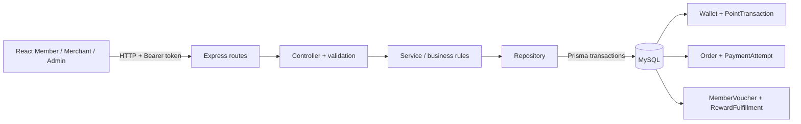

# IncomSG Loyalty Commerce — Demo Technical Guide

> Dùng để giải thích implementation hiện có tại HEAD `389159e`. Mọi trạng thái được mô tả theo source; các flow ghi DB vẫn **chưa VERIFIED** do local DB thiếu `User.isActive` và integration suite không hoàn tất. Xem [Release Readiness Audit](./RELEASE_READINESS.md).

## 1. Kiến trúc tổng quan



- Monorepo dùng npm workspaces; FE là React/TypeScript/Vite, BE Express/TypeScript/Prisma/MySQL.
- API module tách `routes → controller → service → repository`; loyalty calculation/projection nằm trong các helper riêng.
- FE mặc định chọn backend routes; `VITE_API_MODE=mock` mới bật fixture adapter. Mock mode không chứng minh API/DB integration.
- Các route protected dùng JWT Bearer và role middleware. Merchant service lấy merchant thuộc owner đang đăng nhập; Member queries gắn `memberId` từ token.

## 2. Trace API → Service → Repository → DB

| Use case | API hiện có | Trace chính | Persistence |
|---|---|---|---|
| Tạo order | `POST /api/orders` | `orders.routes` → controller → `ordersService.createOrder` → `ordersRepository.createPendingOrder` | Order PENDING + OrderItem snapshot giá/tên; product price được đọc từ DB |
| Thanh toán mock | `POST /api/orders/:orderId/pay` | controller → `paymentsService.payMock` → `ordersService.payOrder` → repository `markPaid` → `completePaidOrder` | PAID + wallet + EARN ledger + earning receipt/tier trong transaction |
| Khởi tạo VNPay | `POST /api/orders/:orderId/payments/vnpay` | controller → `paymentsService.createVnpayPayment` → `paymentsRepository.createAttempt` → `reserveOrderPoints` | PaymentAttempt, expected amount, reserved capacity và snapshot policy/tier |
| Xác nhận VNPay | `GET /api/payments/vnpay/ipn` | service kiểm tra HMAC → repository kiểm tra TMN code/amount/status → claim attempt → release reservation → `completePaidOrder` | Attempt SUCCEEDED/FAILED và kết quả PAID/EARN cùng transaction |
| Đọc ví | `GET /api/member/merchants/:merchantId/wallet` | route auth MEMBER → controller → `getWallet` → `describeWallet`/`describeTransaction` | Membership wallet và transaction list của đúng member/merchant |
| Cấu hình loyalty | `GET/PUT /api/merchant/loyalty` | role MERCHANT → service lấy store theo owner → config repository/validation | LoyaltyRule + tiers riêng theo merchant |
| Redeem voucher | `POST /api/member/vouchers/:definitionId/redeem` | controller đọc `Idempotency-Key` → service → repository transaction | debit wallet + MemberVoucher snapshot + PointTransaction + RedemptionIdempotency |
| Fulfill reward | `GET /api/merchant/rewards`, `POST /api/merchant/rewards/:memberVoucherId/fulfill` | service resolve merchant theo owner → repository kiểm tra voucher cùng merchant → conditional status update | MemberVoucher FULFILLED + RewardFulfillment với actor/note/time |
| Cancel/refund | Không có endpoint | Không có service/repository handler | Order schema chỉ PENDING/PAID; reversal enum mới là khai báo |

Implementation chính: [`orders.service.ts`](../../apps/backend/src/modules/orders/orders.service.ts), [`orders.repository.ts`](../../apps/backend/src/modules/orders/orders.repository.ts), [`payments.service.ts`](../../apps/backend/src/modules/payments/payments.service.ts), [`payments.repository.ts`](../../apps/backend/src/modules/payments/payments.repository.ts), [`loyalty.earning.ts`](../../apps/backend/src/modules/loyalty/loyalty.earning.ts), [`vouchers.repository.ts`](../../apps/backend/src/modules/vouchers/vouchers.repository.ts).

## 3. Công thức earning thực tế

```text
Eligible amount = Order.total = Subtotal - DiscountAmount
EarnedExactPoints = Eligible amount × tier multiplier / VndPerPoint
Stored points = round HALF_UP to 12 decimal places
```

- Server lấy product price, tính subtotal bằng `Prisma.Decimal`, áp discount không vượt subtotal rồi snapshot tổng tiền vào Order. FE không quyết định giá authoritative.
- `calculateEarnedPoints` dùng Decimal clone độ chính xác tính toán 60, validate rate > 0, multiplier và giới hạn số điểm; sau đó làm tròn tới `pointScale = 12` bằng HALF_UP để vừa `DECIMAL(38,12)`.
- Tỷ lệ 10.000 VND/point, multiplier 1.00: hai order 6.000 lần lượt cộng `0.6` và `0.6`; projection là available `1`, carry `0.2`.
- Tier được đọc từ `netLifetimeEarned` trước khi cộng giao dịch; sau EARN code cập nhật net lifetime và membership tier. Redeem chỉ trừ balance, không trừ lifetime.
- VNPay chụp rate, multiplier, tier/policy tại thời điểm tạo payment attempt. Mock payment đọc policy lúc xác nhận PAID.
- **Giới hạn precision:** phép chia vô hạn không giữ được toán học exact sau từng giao dịch; ba lần `1/3` trở thành `0.999999999999`. Đây là quy ước implementation đang có, không phải lỗi ở ví dụ 0.6 + 0.6.

Nguồn: [`loyalty.calculation.ts`](../../apps/backend/src/modules/loyalty/loyalty.calculation.ts), [`order-pricing.ts`](../../apps/backend/src/modules/orders/order-pricing.ts), [`loyalty.earning.ts`](../../apps/backend/src/modules/loyalty/loyalty.earning.ts), [`loyalty.reservation.ts`](../../apps/backend/src/modules/loyalty/loyalty.reservation.ts).

## 4. Wallet và ledger invariants hiện có

- Một `MerchantMembership` duy nhất cho `(memberId, merchantId)`; mỗi membership có tối đa một wallet.
- `exactBalance`, `netLifetimeEarned`, `reservedPoints` lưu Decimal 38,12. `availablePoints`, `fractionalCarry`, `pointDebt` được suy ra từ exact balance:
  - balance dương: available = floor(balance), carry = phần lẻ, debt = 0.
  - balance âm: available = 0, carry = 0, debt = abs(balance).
- `PointTransaction` có `delta`, `balanceAfter`, `type`, `eventRef` unique, source, actor và order/voucher reference. EARN event dùng ref xác định theo order; redemption event theo voucher.
- Không có API sửa/xóa ledger. Wallet và ledger được ghi trong transaction của earning/redemption. Order giữ `earnedPointsExact` và `loyaltySnapshot` làm receipt phục vụ giải thích.
- `reservedPoints` trong code là capacity dành cho các earning đang chờ thanh toán, không phải điểm khả dụng để redeem. VNPay callback nhả reservation trước khi settlement.
- Chưa có EARN_REVERSAL implementation để kiểm chứng reconciliation sau refund. Do đó không được suy từ enum rằng reversal/debt đã hoạt động.

Schema/API: [`schema.prisma`](../../apps/backend/prisma/schema.prisma), [`loyalty.balance.ts`](../../apps/backend/src/modules/loyalty/loyalty.balance.ts), [`loyalty.earning.ts`](../../apps/backend/src/modules/loyalty/loyalty.earning.ts), [`vouchers.repository.ts`](../../apps/backend/src/modules/vouchers/vouchers.repository.ts).

## 5. Atomicity, idempotency, authorization

- **Mock PAID/EARN:** cập nhật order có điều kiện `status=PENDING`; nếu callback/request lặp, không claim order lần nữa. Earning, wallet, ledger, snapshot, tier ở cùng Prisma transaction.
- **VNPay:** verify chữ ký HMAC ở service; repository đối chiếu `txnRef`, merchant code, amount và trạng thái; claim attempt bằng conditional update; duplicate attempt không chạy EARN lần hai.
- **Voucher redeem:** yêu cầu `Idempotency-Key`; unique key theo `(memberId, route, key)`; transaction serializable kiểm tra lại request, debit có điều kiện đủ balance, tạo voucher và ledger. Retry cùng key trả lại voucher đã cấp.
- **Reward fulfill:** query giới hạn theo merchant hiện tại; conditional AVAILABLE → FULFILLED và `voucherId @unique` trên fulfillment chống xử lý trùng.
- **Merchant isolation:** service resolve `merchantId` từ `ownerId`, không nhận merchantId tùy ý cho merchant mutations. Order/voucher read gắn memberId/merchantId theo caller.
- **Chưa được chứng minh:** các invariant trên có source và test, nhưng DB integration suite dừng ở lỗi schema. Không claim đã pass concurrent DB requests hoặc persisted ledger reconciliation.

## 6. Mười lăm câu hỏi phản biện nghiệp vụ

1. **Khi nào Member nhận điểm?** Chỉ sau khi server chuyển Order PENDING thành PAID; pending/failed không gọi earning.
2. **Earning dùng tổng nào?** `Order.total`, đã trừ discount; order và giá item được server snapshot.
3. **Tier multiplier là tier trước hay sau order?** Trước earning; sau khi cộng net lifetime mới cập nhật tier.
4. **Order nâng tier có hưởng multiplier mới ngay không?** Không; multiplier áp cho order được tính trước khi cộng điểm. VNPay giữ tier snapshot ở payment attempt.
5. **Phần lẻ nằm ở đâu?** Nằm trong `LoyaltyWallet.exactBalance`; carry là projection, không có cột carry riêng.
6. **Điểm khả dụng là gì?** Floor của exact balance khi balance dương; phần lẻ không đủ để redeem điểm nguyên.
7. **Point debt được lưu và trả thế nào?** Debt hiện là projection của exact balance âm. Earning cộng vào balance âm nên trả nợ trước; chưa có refund endpoint để tạo debt từ reversal.
8. **Redeem có hạ tier/lifetime không?** Không; chỉ giảm exact balance và thêm REDEEM transaction.
9. **Một member có thể dùng wallet giữa hai merchant không?** Không theo schema: membership unique theo member + merchant; voucher liên kết membership của merchant phát hành.
10. **Retry redeem có cấp hai voucher không?** Cùng Idempotency-Key trả lại kết quả cũ; key dùng với definition khác trả conflict.
11. **Voucher giảm giá bị sửa sau khi cấp thì sao?** MemberVoucher lưu snapshot terms lúc redeem; order kiểm tra voucher thuộc member và merchant, rồi đánh dấu USED khi PAID.
12. **Đổi reward có nghĩa quà đã giao chưa?** Chưa. Voucher ở AVAILABLE/chờ trao đến khi merchant xác nhận; fulfillment row ghi actor và note.
13. **VNPay return URL có xác nhận đã thanh toán không?** Không; IPN chữ ký hợp lệ, đúng amount/merchant/status mới xác nhận. Return chỉ điều hướng về order.
14. **Có thể hủy order PENDING hoặc refund order PAID không?** Chưa; không có API, service, UI hoặc enum order status tương ứng.
15. **Admin có thể suspend/ban member và xem audit không?** Chưa. Có `User.isActive` và login guard, nhưng hiện không có Admin mutation/blacklist/audit API; local DB còn thiếu cột này nên auth đang lỗi.

## 7. Trạng thái demo hiện tại

- `npm test`: PASS, 28 frontend + 37 backend unit tests.
- `npm run typecheck`: PASS.
- `npm run test:db`: không PASS; migrate báo không pending nhưng DB thiếu `User.isActive`, integration setup thất bại.
- Orca Browser: trang login render, không có console JS error; chưa đăng nhập hoặc chạy flow loyalty. API health/DB health trả `ok` nhưng không chứng minh schema đúng.
- **Action trước demo:** sửa/đối chiếu schema app DB và test DB, login thật, chạy DB suite, rồi kiểm tra persisted wallet/ledger. Nếu chưa xong, chỉ demo UI landing hoặc dùng lời trình bày giới hạn; không dùng fixture mock để khẳng định backend flow.
