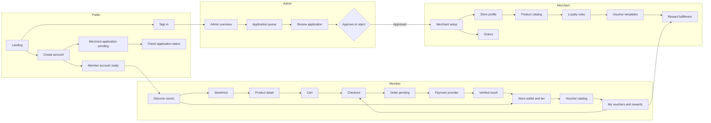
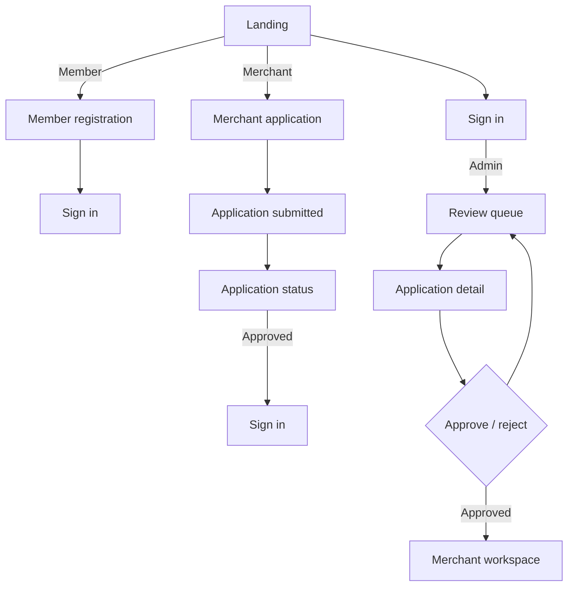
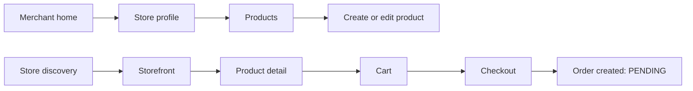
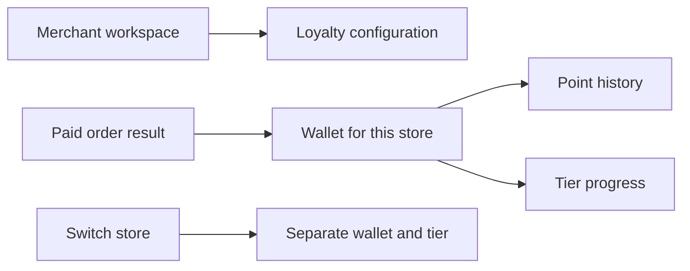
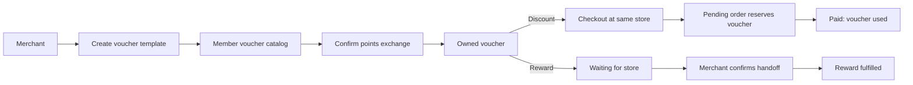
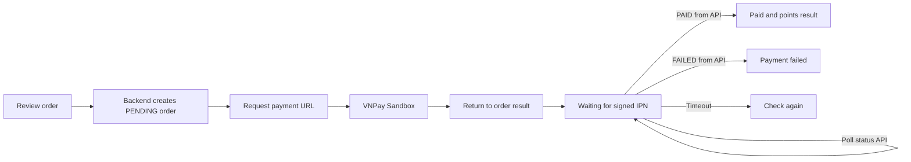

# Loyalty Commerce — Milestone UX Flow and Screen Design

**Status:** Draft for product review  
**Scope:** UI journeys for M1–M6, with detailed screen flow and representative wireframes for every user-facing milestone.

## Intent

Replace the current collection of generic, card-heavy CRUD pages with clear journeys that show why each screen exists and what the user should do next. The design must still reflect the real API boundaries and the BRS rules: each Member–Merchant relationship has its own wallet and tier, points change only after backend responses, and neither voucher nor payment success is inferred by the browser.

## Product outcomes

- A Member can discover a store, buy from it, understand their store-specific progress, and use points in a way that feels rewarding.
- A Merchant can open a store, put products up for sale, configure loyalty, publish vouchers, process orders, and fulfill rewards in an understandable order.
- An Admin can review Merchant applications and monitor the platform without confusing pending, approved, and active states.
- Every screen answers one question and offers one clear next step. Empty and unavailable states guide users without filler copy.

## Out of scope

- Changing backend rules, introducing new endpoints, or reclassifying milestones.
- Zalo, shipping, refunds, point transfers, cross-merchant wallets, or account self-service Admin registration.
- Treating the local mock payment endpoint as a production payment method. Only a verified backend `PAID` response can show payment success; VNPay Sandbox and explicitly selected local demo mode remain separate environments.

## Constraints and design rules

- Use the current React, TypeScript, Vite, Tailwind, shadcn/ui, and React Router stack.
- Keep Member mobile-first. Use a compact bottom navigation on small screens; larger screens may use the same destinations in a top or side rail.
- Keep Merchant and Admin desktop-first, with persistent navigation, compact tables, and detail panels for operational work.
- Scope store data in the UI to the active Merchant context. Switching stores switches catalog, wallet, tier, voucher, order, and history context together.
- The API owns identity, role, Merchant approval/activation, order/payment status, prices, discounts, points, tier, voucher, and fulfillment results.
- Show plain text for statuses in context. Do not add decorative status pills, milestone labels, eyebrow copy, redundant captions, or implementation explanations.
- Use real product/store imagery where available. Member may use the configured `.riv` mascot as optional enhancement; use static art when unavailable or when reduced motion is enabled. Public, Admin, and Merchant views use static artwork or photography.
- Keep loading, empty, error, pending, and success states, but make their text short and action-oriented.
- Preserve distinct HTTP and demo modes. Demo-mode data is clearly confined to that mode; never let mock adapters silently replace a failed live API response.

## Approaches considered

1. **Route map only.** Fastest, but does not address the weak visual hierarchy that prompted this redesign.
2. **Journey map, visual direction, and representative wireframes — selected.** Gives a reviewable design for every milestone without prematurely changing business flows or implementing unapproved screens.
3. **Redesign directly in code.** Produces a visual result sooner, but commits to a new art direction before the user can react and risks hiding API/milestone gaps inside polished screens.

The selected approach is #2. After the wireframes are approved, implementation can be planned milestone by milestone and verified against the real API.

## Visual direction

Give the product the feeling of a small, well-curated marketplace with a loyalty layer: warm paper backgrounds, deep forest-green anchors, restrained citrus highlights, confident editorial headings, and real store/product imagery. Use generous space for Member browsing and tighter, aligned data layouts for operators. Let the loyalty character provide a small moment of delight in Member progress and payment states, rather than adding promotional text or decorative badges to every page.

The design should feel warm and lively through image composition, typography, and purposeful illustration—not gradients, piles of labels, excessive rounded cards, or animation on every screen. Reuse the existing Fraunces and Plus Jakarta Sans families where appropriate.

## Navigation model

### Public

- `/`: concise brand landing with two actions: sign in and create account.
- `/login`, `/register`, `/application/status`: focused account tasks.
- A protected route without a valid session sends the visitor to login and resumes the original route after authentication.

### Admin

- Overview
- Merchant applications
- Merchant directory
- Monitoring

Applications are the first operational task. Merchant directory and monitoring appear only when their real endpoints return data.

### Merchant

- Overview
- Store profile
- Products
- Orders
- Loyalty program
- Voucher templates
- Reward fulfillment

Present these in setup order for a newly approved store: profile → products → loyalty → vouchers. After setup, show orders and rewards as day-to-day work.

### Member

- Discover stores
- Storefront (store context is explicit)
- Cart and checkout
- Orders
- Wallet and tier
- Vouchers and rewards

Every store-specific screen keeps the selected store visible in the navigation. Wallet and tier are always labelled as belonging to that store.

## Cross-milestone journey map



`M1` is data model and infrastructure only; it has no end-user screen. The UI journey begins in `M2` and accumulates capabilities through `M6`.

## Milestone flows and screen inventory

### M1 — Data foundation (no user-facing screens)

No screens. Database entities and constraints establish User, Merchant, Product, Order, MerchantMembership, Wallet, Tier, PointTransaction, VoucherDefinition, MemberVoucher, and RewardFulfillment. Later screens must reflect these ownership boundaries rather than inventing a global wallet.

### M2 — Accounts and Merchant approval

**Journey**



**Screens**

1. Public landing: short promise, one strong storefront/mascot composition, sign-in and registration actions.
2. Registration: select Member or Merchant, then show only the relevant fields. Merchant submission ends on a pending application result with reference ID from the backend.
3. Sign-in: email/password, backend error, and the next useful link. A Merchant still pending or rejected sees the backend's explanation and a route to status lookup.
4. Application status: credential-verified PENDING/APPROVED/REJECTED result; no password in URL or persisted client storage.
5. Admin application queue and review: pending list, application details, approve/reject confirmation, then response-backed result.
6. Merchant first visit: approved store context and a clear first setup action.

**States**: registration busy/error/success; status lookup busy/not-found/decision; Admin queue loading/empty/error; approve/reject busy and backend-confirmed result. No applicant detail is shown unless present in the API DTO.

### M3 — Store catalog and order creation

**Journey**



**Screens**

1. Member store discovery: searchable/browsable active Merchant directory; store identity and available product imagery lead the page.
2. Storefront: Merchant identity first, then active products. Empty store explains that no products are available yet.
3. Product detail: images, name, description, current price, quantity, add-to-cart action.
4. Cart (M3 scope): one product line for one Merchant, matching the current API contract. Buying from another Merchant is a separate checkout. Multi-item carts are future work and must not be implied by this milestone.
5. Checkout and order pending: backend-calculated subtotal, discounts (when M5 exists), total, and PENDING status. Continue to payment when configured; never show PAID here.
6. Merchant catalog: table/list with product image, name, price, active/hidden text state; create/edit form and clear save feedback.
7. Merchant orders: store-scoped orders and their backend statuses. This screen becomes actionable once the read endpoint is available.

**States**: catalog loading/empty/error; cart empty and merchant-specific; product save busy/error/success; order creation response or validation error. A failed request leaves the cart intact.

### M4 — Loyalty wallet and tiers

**Journey**



**Screens**

1. Merchant loyalty configuration: earn ratio and tier thresholds/multipliers in one form, ordered Bronze → Silver → Gold → Platinum; save once and explain that the change applies to future orders.
2. Member wallet: available points, lifetime earned points, current tier, progress to the next tier, and point transaction history.
3. Unranked wallet: show zero/current balance as returned by API and a simple “first paid purchase starts your tier” explanation; do not display a Bronze tier before the first successful payment.
4. Paid order result: show earned points and resulting tier only from the backend payment/order response or a fresh wallet response.

**States**: first-visit empty wallet/Unranked, loading, API error with retry, ledger empty, and progress unavailable when no active loyalty configuration. Spending points changes available balance, not lifetime progress/tier.

### M5 — Vouchers, discounts, and reward fulfillment

**Journey**



**Screens**

1. Merchant voucher templates: one workspace to create/edit/activate discount or reward templates; type-specific fields prevent mixing discount value and reward description.
2. Member voucher catalog: separate visual treatments for discounts and rewards, points cost, and current available balance in the same store context.
3. Redeem confirmation: show points cost and post-redemption balance only when returned by the backend; explain that the exchange cannot be reversed.
4. Member voucher wallet: “ready to use” discounts and “waiting for store” rewards; reserved discount explains which pending order is holding it when the API supplies that link.
5. Checkout with discount: one eligible discount voucher for the same Merchant; show backend subtotal, discount, and total from the order response.
6. Merchant reward queue: member, reward, redeemed date, optional note, confirm handoff action, then response-backed fulfilled state.

**States**: no active templates; insufficient points from API; redeem busy/error/success; voucher reserved or used; reward awaiting fulfillment/already fulfilled; empty Merchant reward queue. No undo/refund action is shown.

### M6 — VNPay Sandbox payment

**Journey**



**Screens/states**

1. Checkout confirmation: final order amounts and chosen discount from backend; clear pay action.
2. Payment handoff: show that checkout is moving to VNPay Sandbox only when backend returns a payment URL.
3. Order result waiting: payment returned but backend IPN has not confirmed it. Keep status pending and poll the status endpoint.
4. Paid result: show paid status and backend-confirmed points/tier. Refreshing the page reads the order/payment status API again.
5. Failed result: show backend failure and a safe next step; do not retry the same failed attempt unless a retry endpoint is explicitly provided. A new order is a separate purchase.
6. Timeout/offline result: preserve the order and let the Member check status again; do not convert a timeout into a failure or success.

Local mock payment remains confined to explicit local demo configuration. It must be visually distinguishable from Sandbox/live payment during development and must not be enabled by the production build.

## Representative wireframes

The wireframes are structural, not final pixel specifications. Numeric values are examples and must be replaced with API data. Text labels are short; status remains readable text rather than decorative chips.

### Public landing — desktop

```text
┌──────────────────────────────────────────────────────────────────────┐
│ loyalty.                                           Đăng nhập  Tạo TK │
│                                                                      │
│  Mua ở nơi bạn yêu thích.              ┌──────────────────────────┐  │
│  Mỗi lần quay lại,                     │                          │  │
│  thêm một điều đáng nhớ.               │   Store / Member artwork │  │
│                                        │   (static illustration)  │  │
│  Tích điểm riêng tại từng cửa hàng.    │                          │  │
│  [Khám phá cửa hàng] [Tạo tài khoản]   └──────────────────────────┘  │
└──────────────────────────────────────────────────────────────────────┘
```

### M2 — Admin application review

```text
┌──────────────┬───────────────────────────────────────────────────────┐
│ loyalty.     │ Hồ sơ chờ duyệt                           Tìm kiếm   │
│ Overview     ├───────────────────────────────────────────────────────┤
│ Hồ sơ  •     │  {số hồ sơ từ API} đang chờ  ·  bộ lọc trạng thái    │
│ Cửa hàng     │ ┌───────────────────────────────────────────────────┐ │
│              │ │ Tên cửa hàng          Gửi lúc       Xem hồ sơ →   │ │
│              │ │ ...                                              │ │
│              │ └───────────────────────────────────────────────────┘ │
└──────────────┴───────────────────────────────────────────────────────┘
```

### M3 — Member storefront and checkout

```text
┌───────────────────────────────────┐     ┌─────────────────────────────┐
│ ← Cửa hàng                        │     │ Xác nhận đơn                │
│                                   │     │ Sản phẩm       Số lượng     │
│ [Store cover / image]             │     │ Tạm tính             API    │
│ Tên cửa hàng                      │     │ Giảm giá            API*    │
│                                   │     │ Tổng cộng            API    │
│ Sản phẩm nổi bật                  │     │                             │
│ [Ảnh] Tên              Giá        │     │ [Tạo đơn chờ thanh toán]    │
│ [Ảnh] Tên              Giá        │     └─────────────────────────────┘
│ Store  Ví  Voucher  Đơn  Giỏ      │
└───────────────────────────────────┘
* Voucher discount appears from M5 onward.
```

### M4 — Member wallet

```text
┌───────────────────────────────┐
│ Cửa hàng đang xem             │
│ {điểm khả dụng từ API}        │
│ 1.840 lifetime points         │
│ Silver                        │
│ ███████░░░ 3.160 điểm tới Gold│
│ Hạng dựa trên điểm tích lũy   │
├───────────────────────────────┤
│ Lịch sử điểm                  │
│ +31  Đơn hàng       08/11     │
│ -200 Đổi voucher    06/11     │
│ +46  Đơn hàng       04/11     │
├───────────────────────────────┤
│ Cửa hàng  Ví  Voucher  Đơn    │
└───────────────────────────────┘
```

### M5 — Voucher catalog and rewards

```text
┌──────────────────────────────────────┐
│ Ưu đãi của Cửa hàng A    1.840 điểm │
│ Loại: Giảm giá · 20.000đ     200 điểm │
│                         [Đổi voucher]│
│ Loại: Quà tặng · Một chiếc ly 500 điểm │
│                         [Đổi voucher]│
├──────────────────────────────────────┤
│ Voucher của bạn                      │
│ Giảm giá · sẵn sàng dùng             │
│ Quà tặng · đang chờ cửa hàng trao    │
└──────────────────────────────────────┘
```

### M6 — Payment result

```text
┌──────────────────────────────────────┐
│ Đơn hàng #1042                       │
│                                      │
│       Đang chờ xác nhận thanh toán   │
│       Đang kiểm tra trạng thái…      │
│                                      │
│ Tổng cộng                    180.000đ│
│                                      │
│              [Kiểm tra lại]          │
│                                      │
│ Mascot tĩnh / Rive tùy chọn          │
└──────────────────────────────────────┘
```

## Component and visual behavior

- Member store header owns the active Merchant context, cart count, and simple navigation. Store switch returns to discovery and does not merge carts or wallets.
- Product cards use image, name, price, and one obvious action. Avoid decorative rating/count fields unless API provides them.
- Wallet progress uses a single tier progress visualization plus numeric lifetime total. Do not display inferred “points left” if thresholds/config are missing; render only when the API provides the needed values.
- Operational tables use plain statuses, aligned numeric columns, and row-level actions. Confirmation dialogs are reserved for decisions that change application, product, voucher, or fulfillment state.
- Page headers contain only a title and, when useful, one primary action. Descriptions are omitted when the title and layout already explain the task.
- Rive loads only on Member screens that benefit from it, only when enabled and motion is allowed. Keep a static fallback visible during load and on failure.

## API and milestone gates

| Milestone | Screens unlocked | Backend confirmation required |
| --- | --- | --- |
| M1 | None | Schema/ownership constraints only |
| M2 | Auth, application status, Admin queue/review, Merchant entry | Auth response, application response, approval result |
| M3 | Store directory, catalog, product detail, cart, pending order, Merchant products/orders | Store/product DTOs, price and PENDING order DTO |
| M4 | Loyalty configuration, store-scoped wallet, tier and ledger | Saved config, wallet totals/tier, earned-points order result |
| M5 | Voucher templates, catalog, redemption, discount checkout, reward queue | Redeemed voucher + wallet, order discount, fulfillment response |
| M6 | Payment handoff, waiting, paid/failed/timeout result | Payment URL and status API; signed IPN-backed PAID |

If an endpoint is absent in the target environment, the screen uses a concise unavailable state and cannot offer a fake success action. The capability may be hidden until its endpoint exists.

## Success criteria

- Each milestone tells a complete, role-specific story in the journeys above.
- Members can tell which Merchant owns their points, tier, vouchers, and orders at every step.
- Merchant setup has an obvious order; daily operations are reachable without returning to setup pages.
- Admin can distinguish application review from monitoring and directory work.
- No user-facing layout depends on decorative badges or repeated explanatory blocks.
- Every success, balance, tier, discount, and payment state is traceable to a backend response.
- The Member journey remains usable at 360px wide and supports reduced motion and missing Rive assets.

## Open design work left to implementation

- Final spacing, responsive breakpoints, product photography/crop rules, and empty-state artwork.
- Exact directory filters/search only where the active backend supports them.
- Which dashboard summary metrics appear when Admin and Merchant APIs supply them.
- The approved visual mockups and screen-by-screen route acceptance checklist.
