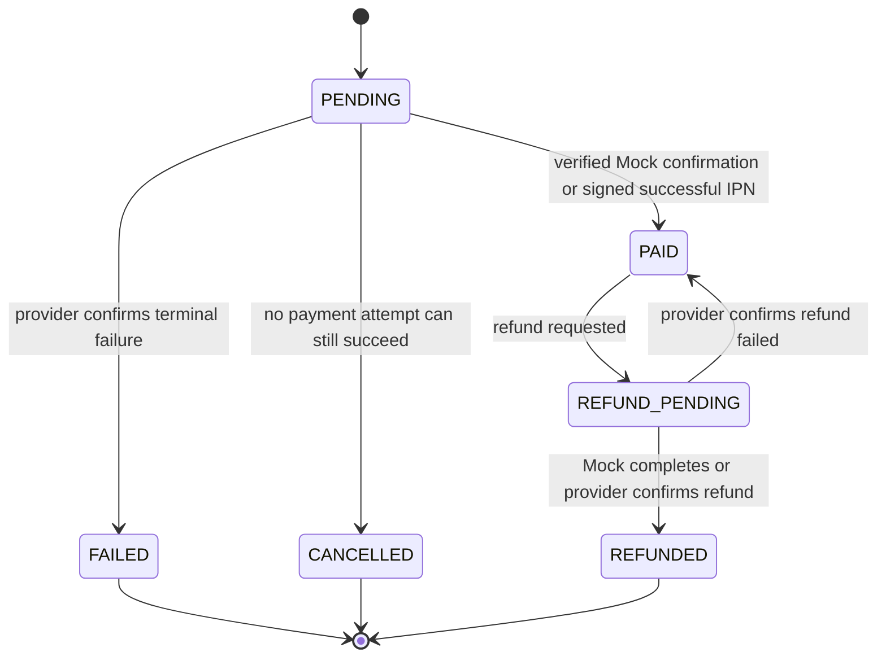

# IncomSG Loyalty Commerce Demo — M0 Business and API Contract

**Goal:** Complete the existing IncomSG commerce demo as a persisted, role-scoped loyalty experience without replacing working modules.

**Accepted scope:** The user's M0–M10 backlog dated 2026-11-11. M1 Exact Earning + Carry is already shipped in commit `e2439ae`; this spec covers M2–M10 and the cross-role contract. Full refunds only. No partial refunds, automated fraud scoring, or voucher quota system.

## Current repo facts

- Backend already has registration/login, merchant approval, catalog, pending order creation, Mock/VNPay payment, exact M1 wallet/earning, voucher redemption, reward fulfillment, and Admin dashboard/application/directory reads.
- The wallet route is `GET /api/member/merchants/:merchantId/wallet`; member orders, merchant orders, loyalty config, vouchers, reward fulfillment and Admin read APIs are mounted.
- `OrderStatus` currently has `PENDING`/`PAID`; `PaymentAttemptStatus` has `CREATED`/`SUCCEEDED`/`FAILED`; reward/member-voucher status is shared. `Order.voucherId`, `PointTransaction.orderId` and `PointTransaction.memberVoucherId` are unique today.
- Backend payment and M1 earning use Prisma Serializable transactions and exact decimals. Account inactive checks and role guards already run in authentication middleware.
- HTTP frontend already has Member shop/cart/checkout/wallet/vouchers/rewards/orders, Merchant overview/store/products/orders/loyalty/vouchers, and Admin overview/applications/merchants. Merchant rewards currently redirects to orders. Keep these routes and add tabs/details only where practical.

## State contract

- `FULFILLED` is a reward-voucher/fulfillment state, not an order or payment state.
- `MemberVoucher` status depends on snapshot type: discounts use `AVAILABLE → RESERVED → USED` (refund may restore `USED → AVAILABLE`); rewards use `PENDING_FULFILLMENT → FULFILLED` or `CANCELLED`. Backfill existing unfulfilled reward vouchers from `AVAILABLE` to `PENDING_FULFILLMENT`.
- Account access has one source of truth: `User.accountStatus` is `ACTIVE`, `PENDING_APPROVAL`, `REJECTED`, `SUSPENDED` or `BANNED`; remove the persisted `isActive` boolean and keep the existing API `isActive` as a derived compatibility field. Merchant approval changes `PENDING_APPROVAL → ACTIVE`; suspension/ban never deletes commerce history.
- A timed-out `CREATED` payment remains unresolved and blocks cancel/refund completion. A stale indicator is operational metadata only; it must never auto-change payment to `FAILED`.
- A late or duplicate IPN is handled through conditional state transition plus unique event reference. Only one successful transition may post EARN.
- A refund record is unique per order (P0 full refund). Mock can complete immediately. VNPay remains `PENDING_PROVIDER`/`REFUND_PENDING` until a real provider confirmation is received; a frontend click or unverified manual action cannot set `REFUNDED`.
- Member may cancel a pending order only if no provider attempt can still succeed. A stale `CREATED` attempt must be reconciled first. Cancel releases a reserved discount voucher and exact earning-capacity reservation without deleting the order.

## Loyalty and ledger invariants

- Persist exact signed wallet balance and lifetime-earned values as `DECIMAL(38,12)`; `availablePoints`, carry and debt are derived from the exact balance. Carry is scoped to one member/merchant wallet and is unchanged by policy/tier edits or integer redemption.
- `netLifetimeEarned = SUM(EARN) - SUM(EARN_REVERSAL)`; redemption and redemption reversal do not affect lifetime tier points.
- `wallet.exactBalance = SUM(all ledger deltas)` including EARN, both redemption types and reversals. Append-only ledger; each posted event has a unique `eventRef`.
- Every ledger event stores `actorId` (nullable for provider/system) and an immutable `source`: `MOCK_PAYMENT`, `VNPAY_IPN`, `MEMBER_REDEMPTION`, `MERCHANT_REFUND`, `MERCHANT_REWARD_CANCELLATION`, `ADMIN_ADJUSTMENT`, `LEGACY_BACKFILL` or `SYSTEM`. Existing rows backfill as `LEGACY_BACKFILL` with null actor.
- Order earning reversals use the exact persisted `earnedPointsExact`; wallet balance may become negative and is projected as zero available, zero carry and positive point debt. New EARN pays debt before creating spendable points.
- Tier is recalculated from exact net lifetime and current thresholds before earning/read; spending never lowers it. A full refund may lower tier.
- Redemption uses integer cost against the signed exact balance, checks the wallet after debt, snapshots voucher terms, and is idempotent by `Idempotency-Key` plus member and request body hash.
- Discount voucher reservation is exclusive while an order is pending. Keep prior cancelled/failed order references for audit, but clear the active reservation so the voucher can be reserved by a later order. A completed full refund restores its used discount voucher once.
- Reward cancellation is Merchant-only before fulfillment; it restores the exact integer redemption cost using `REDEMPTION_REVERSAL` once. A fulfilled reward cannot be cancelled or refunded through this action.

## API contract

All errors retain `{ "error": "CODE" }`; 401 means unauthenticated, 403 means wrong role/ownership or inactive account, 404 hides foreign resources where current APIs do so, 409 means a valid request conflicts with current state. Paginated lists use `{items,nextCursor}`. Money/points exact values are decimal strings.

| Method and path | Role | Contract |
|---|---|---|
| `GET /api/member/merchants/:merchantId/wallet` | Member | Existing route; exact balance/carry/debt/lifetime, current tier and exact ledger. |
| `POST /api/member/merchants/:merchantId/loyalty/preview` | Member | `{netOrderAmountVnd:string}` → policy/tier and `estimatedPointsExact`; estimate only, never a credit. |
| `GET /api/member/orders?merchantId=` / `GET /api/member/orders/:orderId` | Member | Existing routes; include order/payment/refund state and earning/reversal audit. |
| `POST /api/orders/:orderId/cancel` | Owner Member | Cancels only safely unpaid order; returns persisted order and release result. |
| `POST /api/member/vouchers/:definitionId/redeem` | Member | Existing route; requires `Idempotency-Key`; replay returns the same voucher, reused key with different body is 409. |
| `GET /api/merchant/loyalty/transactions` | Merchant | Filters `memberId`, `orderId`, `type`, `from`, `to`, cursor/limit; merchant-scoped ledger only. |
| `POST /api/merchant/loyalty/preview` | Merchant | `{netOrderAmountVnd:string,tierLevel?}` → exact formula preview without DB writes. |
| `GET /api/merchant/orders/:orderId/refund-preview` | Owning Merchant | Full refund amount, exact earning reversal, projected wallet debt/tier and voucher restoration eligibility; read-only. |
| `POST /api/merchant/orders/:orderId/refund` | Owning Merchant | `{reason:string}` → persisted refund status. Mock may return `COMPLETED`; VNPay returns `PENDING_PROVIDER` until confirmed. Idempotent by order. |
| `GET /api/merchant/rewards` | Merchant | Existing route; paginated queue with `PENDING_FULFILLMENT`, `FULFILLED`, `CANCELLED` and audit fields. |
| `POST /api/merchant/rewards/:memberVoucherId/fulfill` | Merchant | Existing route; fulfills once with actor/time/note. |
| `POST /api/merchant/rewards/:memberVoucherId/cancel` | Merchant | Cancels only unfulfilled reward; appends `REDEMPTION_REVERSAL` and returns wallet + audit. |
| `GET /api/admin/users` | Admin | Search/status filter; no credentials or wallet deletion. |
| `PATCH /api/admin/users/:userId/status` | Admin | `{status:"ACTIVE"|"SUSPENDED"|"BANNED",reason}`; writes immutable audit decision. |
| `GET /api/admin/email-blacklist` / `POST /api/admin/email-blacklist` | Admin | Add normalized email and reason; existing account/login and registration checks use same normalized value. |
| `POST /api/admin/email-blacklist/:id/deactivate` | Admin | `{reason}`; deactivate instead of deleting history. |
| `GET /api/admin/audit-logs` | Admin | Filter actor, action, target, date; read-only append-only history. |
| `POST /api/merchant/abuse-reports` | Merchant | `{memberId,orderId?,reason}`; creates report only and cannot suspend/ban/blacklist. |

Payment API compatibility: keep existing `POST /api/orders/:orderId/pay`, `POST /api/orders/:orderId/payments/vnpay`, `GET /api/orders/:orderId/payment-status` and signed VNPay IPN. Existing request retries remain idempotent. A stale payment is flagged for reconciliation but is never auto-failed or auto-cancelled.

### Response DTOs

- `WalletDto`: `{merchantId,exactBalance,availablePoints,fractionalCarry,pointDebt,netLifetimeEarned,lifetimeEarnedPoints,tier,policy,transactions}`. Decimal values are strings; integer fields are projections only. Each transaction is `{id,eventRef,type,delta,balanceAfter,availablePointsAfter,fractionalCarryAfter,pointDebtAfter,orderId,memberVoucherId,reason,source,actorId,createdAt}`.
- `OrderDto`: existing identity, status, totals and item snapshots plus `{paymentStatus,refundStatus,earnedPointsExact,loyaltyEvents,actions}`. `loyaltyEvents` contains exact EARN/REVERSAL events. `actions` is computed by the backend: `{canCancel,canRefund,requiresReconciliation}`. The FE must not infer permission from status alone.
- Cancel success: `{order,voucherReleased,capacityReleasedExact}`. Cancel conflict returns `409 ORDER_NOT_CANCELLABLE` with the current order/payment states.
- Member earning preview: `{merchantId,active,netOrderAmountVnd,tierLevel,multiplier,vndPerPoint,estimatedPointsExact,policyUpdatedAt}`. It is an estimate only; it creates no ledger entry and does not promise the later settlement policy.
- Merchant preview: `{netOrderAmountVnd,tierLevel,multiplier,vndPerPoint,active,estimatedPointsExact,integerProjection,fractionalProjection,rounding:"HALF_UP",scale:12}`.
- Refund preview: `{orderId,refundAmountVnd,refundStatus,earningReversalExact,walletBefore,walletAfter,tierBefore,tierAfter,discountVoucherRestorable,providerConfirmationRequired}`. `walletBefore/After` use the WalletDto projections. It writes no DB state.
- Refund request: `{refund:{id,status,amountVnd,reason,requestedById,requestedAt,completedAt,providerReference},order,walletImpact}`. For VNPay, `walletImpact` is null until provider confirmation and status remains `PENDING_PROVIDER`.
- Merchant ledger list: `{items,nextCursor}`; each item is a ledger transaction plus `memberId`, normalized email, order summary and voucher summary. Filters are applied server-side and never cross merchant ownership.
- Reward queue item: `{memberVoucherId,status,memberId,memberEmail,title,pointsCost,requestedAt,fulfilledAt,cancelledAt,fulfilledById,cancelledById,note,cancellationReason}`.
- Admin account: `{id,email,role,accountStatus,isActive,createdAt}`. Audit item: `{id,actorId,actorEmail,action,targetType,targetId,reason,before,after,createdAt}`. Blacklist item retains normalized email, reason, actor and deactivation history.

## Admin access and audit policy

- Only Admin can change account access status or email blacklist. Merchant reports are evidence for review, not enforcement.
- Every Admin decision stores actor ID, target, action, reason, timestamp and before/after status. Deactivation/unban adds a new audit event; it never deletes the previous one.
- Suspending/banning does not delete Member wallet, ledger, orders, vouchers or reward history. Authentication/middleware rejects inactive accounts immediately.
- Email comparison uses existing `trim().toLowerCase()` normalization. Blacklisting blocks new registration and login; Admin may deactivate a blacklist record with a reason.

## Navigation and UX contract

- **Member:** retain store-scoped storefront/product/cart/checkout, order detail/history, wallet/tier, vouchers and rewards. Combine Membership & Tier into Wallet. Add payment/refund/reversal history and safe Cancel only when backend says allowed. Mobile-first.
- **Merchant:** retain overview, store, products, orders, loyalty config, vouchers and reward fulfillment. Add refund management as an Orders tab/detail drawer and ledger search as a Loyalty tab. Desktop-first, responsive on narrow screens.
- **Admin:** retain overview, applications and merchants. Add Users and Blacklist/Audit views; moderation uses confirmation with required reason and API response. Desktop-first.
- Use the existing console/member layouts, controls, typography and spacing. Keep the current app's visual identity. Do not display success, balances, tier changes, refund completion, or fulfillment until confirmed by backend responses. All role and ownership checks remain server-side.
- Every list/form includes loading, empty, recoverable error, pending and confirmed states. Use accessible labels, keyboard operation, visible focus, responsive tables/cards and reduced-motion support.

## Decisions kept out of scope

- No partial refunds, refunding already-fulfilled rewards, automatic fraud scoring, destructive wallet/ledger cleanup, or quota campaign engine.
- No production database migration, push, merge or PR without a separate request. Apply schema changes only to local `incomsg-test` during QA.
